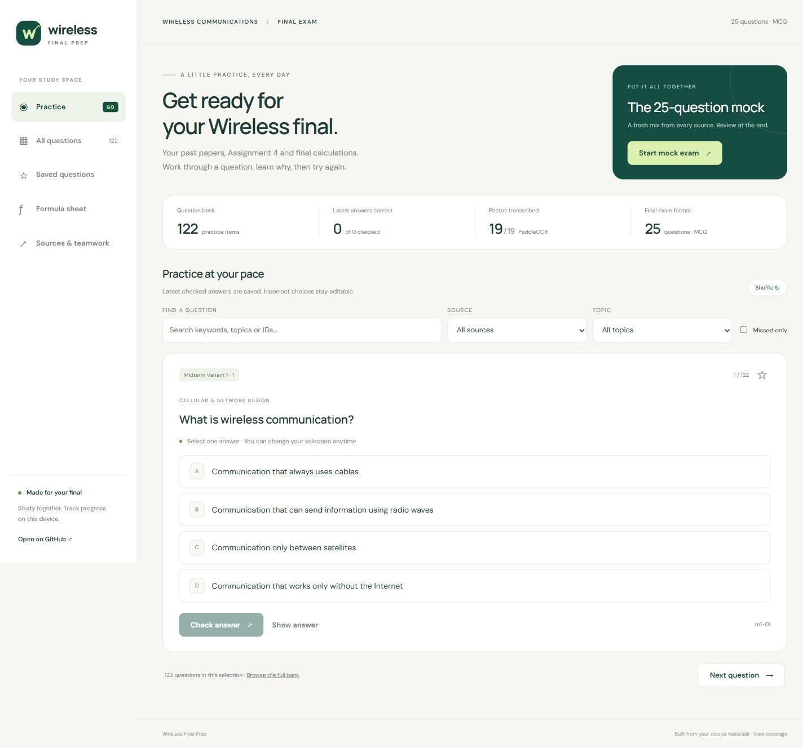
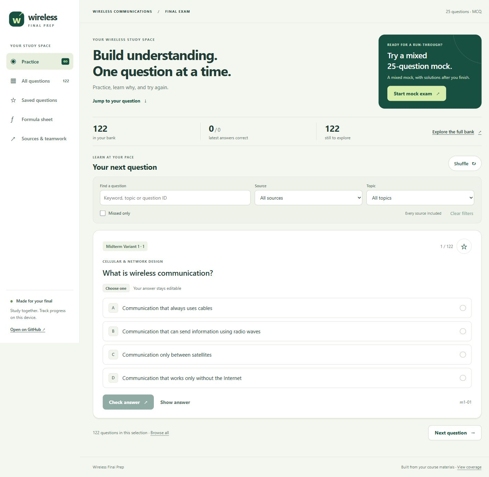
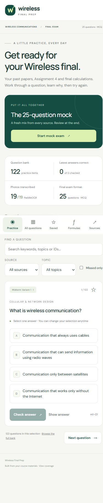
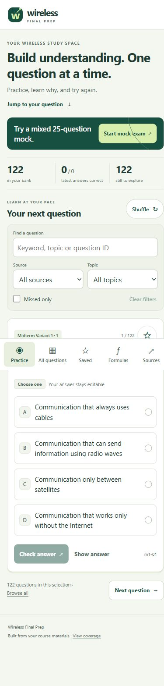
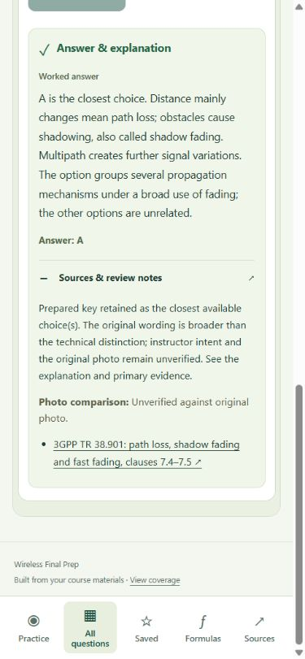
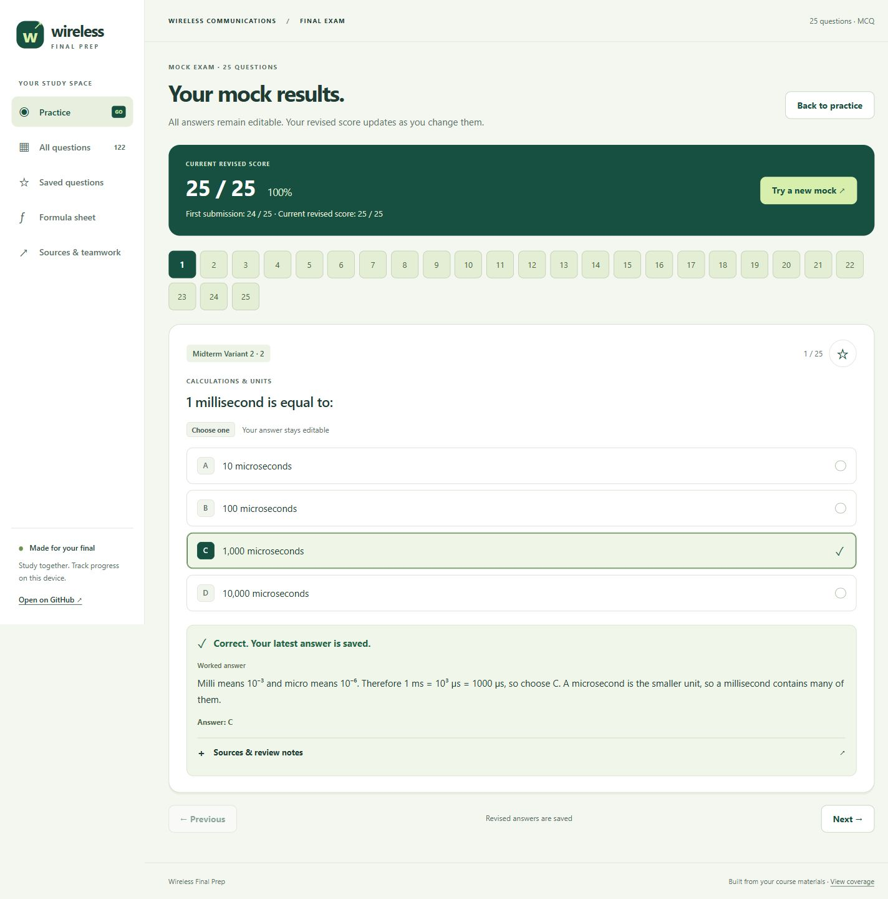

# Contribution verification

Verified on 17 November 2026 using the local HTTP-served site in the Chromium-based in-app browser. Desktop viewport: **1440 × 1000**. Phone viewport: **390 × 844**. The browser checks below were performed through the rendered interface; they are not claims of a comprehensive automated browser suite.

The baseline screenshots show `main` at `a7707a64a137f49a9008e13c329cbf9cbc123768`, before the UI changes. The after screenshots show this contribution at the same viewport sizes.

## Before and after

| Viewport | Before | After |
| --- | --- | --- |
| Desktop, 1440 × 1000 |  |  |
| Phone, 390 × 844 |  |  |

## Browser behavior

| Check | Action and observed result |
| --- | --- |
| Single-answer correction | Desktop `m1-01`: checked the wrong A, changed to B, and observed the correct feedback immediately. Arrow Right changed B to C; Arrow Left returned to B, retaining keyboard focus and updating the result. Saving and reloading preserved the bookmark and checked B. |
| Exact-set grading | Desktop `m1-14`: incorrect A+B became correct A+C. Adding D made the selection incorrect; removing D restored the correct result. Answers remained editable throughout. |
| Complete bank and layouts | Both list and card views contained all **122** questions. List rows expanded into editable question cards. |
| Search and combined filters | Variant 2 returned **23** questions; Variant 2 plus Calculations & units returned **6**. Searching the topic text `OSI & protocols` returned **12**. A query with no matches showed the empty state; clearing filters restored the bank. |
| Missed review | Checked wrong A for `m1-02`; missed-only review showed one question. Changing to C removed it from the missed list, which then showed zero, and announced the removal in a toast. |
| Saved review | Saved view retained `m1-01` with checked B after reload. |
| Complete mock | Answered all **25** distinct question IDs in one mixed mock. Solutions remained hidden on each question until finishing. Free navigation remained available. The intentional wrong answer on `m2-02` produced **24/25** on first submission. |
| Mock revision and persistence | Correcting `m2-02` changed the revised score to **25/25** while first submission stayed **24/25**. Reload preserved both values. |
| Phone mock editing | On the same finished mock, changed question 1 to wrong and back to correct. On question 25 (`m2-25`), removed A from the correct set and added it back. The revised score changed **25/25 → 24/25 → 25/25**; the first score remained **24/25**, including after reload. |
| Phone practice and browsing | `m1-10` changed from wrong B to correct A. Removing and restoring C on `m1-14` updated exact-set feedback. List and card views retained all **122** items; Show all answers displayed **122** feedback sections. Search and clear-filter controls worked. |
| Keyboard skip link | On Sources, activating Skip to questions focused `main` while retaining the `#sources` route. |
| Layout and console | No page-level horizontal overflow was observed on the tested practice, bank, mock, Sources or Formulas views. Screenshots were inspected for clipping and fixed phone navigation covering controls; footer text remained readable. Mock navigation buttons measured **44 × 44 CSS pixels**. Captured browser error and warning logs were empty. |

### Evidence and result details

The phone evidence disclosure exposes the technical source links, wording caveat and unverified photo-comparison status:



The mock review keeps the original submitted score separate from the revised learning score:



The **24/25** and **25/25** scores are deliberate QA outcomes from one local test mock. They are not student results and do not establish technical correctness of the bank.

## Repository checks

The following checks passed locally:

```sh
node scripts/validate.mjs
node --check app.js
node --check model.js
node --check scripts/validate.mjs
node --check scripts/review-check.mjs
git diff --check
```

Validation covers the 122-item bank, all 48 transcript-to-bank mappings, evidence metadata, 19 recorded OCR inputs, reviewed answer sets, seven past-paper multi-selects, model answer editing, exact-set grading, 25-question mock scoring and independently recomputed answers to 11 past-paper calculation questions. The four ambiguous wording flags and the explicit coverage gaps remain present.

A separate comparison with the baseline confirmed that every original past-paper ID, prompt, choice array, answer index, selection count and source mapping is unchanged. All **74** Assignment 4 and Last-practice entries are unchanged. The 48 reviewed past-paper items now distinguish **37 Worked answers** from **11 Worked calculations**. Technical evidence and review reasoning are recorded in [the answer review](../sources/answer-review.md); script success does not establish answer correctness.

## Verification limits and remaining source gaps

- The phone checks used a 390-pixel browser viewport, not a physical handset. Other browser engines and assistive technologies were not tested.
- The original 19 photos were unavailable for comparison. All 48 transcriptions therefore retain **unverified photo fidelity**; agreement between the JSON and Markdown transcript cannot prove the OCR matches a photo.
- No official past-paper marking scheme was supplied. The prepared keys remain worked answers or worked calculations. Handwritten selections were not accepted as official feedback.
- Variant 2 questions **16–17** and a separate endterm-labeled source remain unavailable. No questions were invented, and complete final-exam coverage is not claimed.
- The broad wording in `m1-10`, `m1-25`, `m2-22` and `m2-23` remains flagged despite the expanded technical explanations. These distinctions need the original source or instructor clarification to establish the intended terminology.
